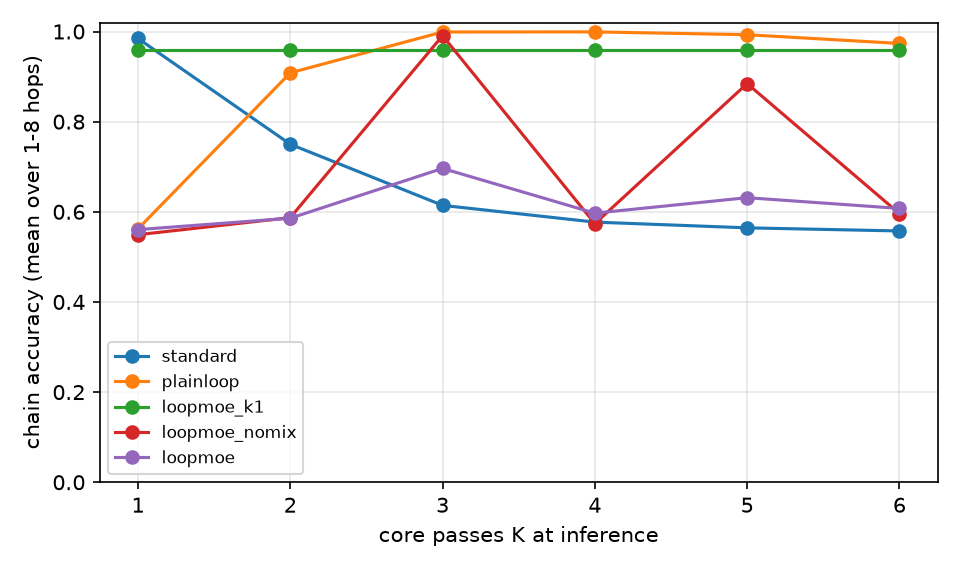
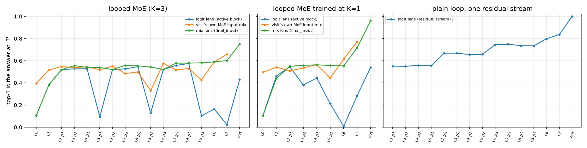

# nanoloop-moe

A small, readable looped mixture-of-experts transformer in the style of Inkling 2 Mini. One file of PyTorch
(`nanoloop_moe.py`): a prelude, a core that runs K times with shared weights, a coda, a top-k MoE in every layer,
**no single residual stream** (each sublayer reads its own learned mix of finished blocks), and a **gated message**
from one core pass to the next. You choose K at inference.

> An Inkling-style toy built from public sources. Not affiliated with, endorsed by or derived from the weights of
> Thinking Machines. "Inkling" is Thinking Machines' product name.

[](https://colab.research.google.com/github/albertlieyingadrian/nanoloop-moe/blob/main/notebooks/quickstart.ipynb)

```
 ordinary transformer: one running sum             this model: a list of finished blocks

  x = embed                                        blocks = [embed]        h = the active block
  x = x + attn(x)                                  every sublayer reads mix(blocks + [h]):
  x = x + ffn(x)        (every layer adds          its own learned softmax over blocks
  ...                    to the same x)            at a block boundary h is frozen into blocks
  logits = head(x)                                 logits = head(final_input mix(blocks + [h]))

 the loop (3 core passes):

  embed -> [prelude] --+--> [core pass 1] --+       each pass restarts from the prelude's blocks;
                       |                    | bank  the previous pass reaches the next one only as
                       +--> [core pass 2] <-+--+    a message: x <- (1 - g_forget) * x + g_message * msg
                       |                       | bank
                       +--> [core pass 3] <----+
                                  |
                               [coda] -> final_input mix -> logits
```

## Quickstart

```bash
git clone https://github.com/albertlieyingadrian/nanoloop-moe && cd nanoloop-moe
pip install -r requirements.txt                 # torch, numpy, matplotlib (plots only)
python test_nanoloop_moe.py                     # 12 checks, about 2 s on CPU
python nanoloop_moe.py --mode compare           # chain task, 5 models (GPU: ~15 min each; see below for CPU)
python nanoloop_moe.py --mode sample --out out/chain_loopmoe.pt --loops 1   # same weights, 1 core pass
python nanoloop_moe.py --mode sample --out out/chain_loopmoe.pt --loops 3   # and 3
python nanoloop_moe.py --mode lens              # logit lens vs mix lens, per layer visit
python nanoloop_moe.py --mode plot              # assets/k_sweep.png and assets/lens.png
python nanoloop_moe.py --mode score --tag long  # re-score saved checkpoints, e.g. out/chain_loopmoe_long.pt
python nanoloop_moe.py --mode compare --task shakespeare --steps 3000
modal run modal_run.py                          # the same compare on Modal H100s, one container per model
```

Every field of `Config` is a flag: `--loops 5 --mix 0 --messages 0 --moe 0 --n_shared 1 --block_layers 6 ...`.
On a laptop CPU the default chain runs take hours (the MoE runs every expert on every token, which is fast on a GPU
and slow on a CPU); `--n_embd 64 --steps 2000` or the notebook's small settings make a quick look.

## Results

All runs: chain task with chains of 1 to 8 hops, width 128, batch 128, AdamW 5e-4, the curriculum from
nanoloop-transformer, held-out set of 1,000 puzzles, seed 1337 unless noted. Accuracy is the share of `?` positions
answered correctly, averaged over hop counts 1-8. **Chance is about 0.55**: a model that guesses one of the two
digits in the prompt lands there. The JSON behind every number is in `results/`.

To rerun: `modal run modal_run.py --steps 20000 --tag long` (or `python nanoloop_moe.py --mode compare --steps 20000`
on a GPU), then `--mode lens --tag long` and `--mode plot --tag long`. The 6k columns are the default `--steps`, with
`--seed 1` for the second seed.

Five models at matched **active** parameters per token (the MoE models store 2.6x more, in idle experts):

| model | stored | active | K trained | 6k steps, seed 1337 | 6k steps, seed 1 | **20k steps** |
|---|---:|---:|---:|---:|---:|---:|
| standard transformer, 8 layers, one stream | 1.32M | 1.32M | 1 | 0.570 | 0.653 | 0.985 |
| plain loop (nanoloop-transformer recipe) | 1.32M | 1.32M | 3 | **0.986** | **0.998** | **0.999** |
| looped MoE, trained without the loop | 3.84M | 1.48M | 1 | 0.589 | 0.664 | 0.960 |
| looped MoE, loop + messages, no block mixing | 3.84M | 1.48M | 3 | 0.672 | 0.629 | 0.991 |
| **looped MoE, full (this model)** | 3.84M | 1.48M | 3 | 0.561 | 0.568 | 0.696 |

Changing K at inference (20k-step models; mean accuracy over 1-8 hops):

| K at inference | 1 | 2 | 3 | 4 | 5 | 6 |
|---|---:|---:|---:|---:|---:|---:|
| plain loop | 0.562 | 0.908 | 0.999 | 0.999 | 0.993 | 0.974 |
| looped MoE, no block mixing | 0.549 | 0.587 | 0.991 | 0.574 | 0.884 | 0.596 |
| looped MoE, full | 0.560 | 0.586 | 0.696 | 0.597 | 0.631 | 0.608 |
| looped MoE, trained at K=1 | 0.960 | 0.960 | 0.960 | 0.960 | 0.960 | 0.960 |
| standard (core forced to repeat) | 0.985 | 0.750 | 0.614 | 0.577 | 0.564 | 0.558 |



What this shows, at this toy scale:

- **The Inkling-style loop is much harder to train than a plain loop.** With one residual stream carried from pass to
  pass, the loop solves 8-hop chains in 6,000 steps in both seeds. Restarting every pass from the prelude and passing
  only a gated message needs about 3x the steps (no mixing: 0.63-0.67 at 6k, 0.991 at 20k). With block mixing as well,
  the full model was still at 0.696 after 20,000 steps; its curriculum stopped at 5 hops. Training is also fragile: a
  second copy of that run (same seed, a different GPU, stopped by a lost connection) had reached 6 hops by step
  4,140, where this one was still at 3 hops at step 10,000. Treat the full model's number as "slow and unstable to
  train here", not as a ceiling.
- **Only the trained K works.** The plain loop keeps 0.97 or better from K=3 to K=6. The message-passing loop
  without mixing is 0.991 at K=3 and 0.57-0.88 at any other K. Inkling 2 Mini also supports only its trained loop
  count; its release says a separate research model was trained with 1 to 5 passes to study other counts.
- **Without messages, K does nothing**, by construction: each pass restarts from the prelude's blocks. The model
  trained at K=1 scores 0.960 at every K (a test checks this property).
- **Block mixing on its own works.** Without the loop, the block-mixing MoE reaches 0.960 at 20k steps, close to the
  standard transformer (0.985) with the same active parameters.
- **On Tiny Shakespeare** (3,000 steps, context 96), validation loss at the trained K: standard 1.640, plain loop
  1.622, looped MoE without the loop 1.784, without mixing 1.757, full 1.817. Text at this size is not depth-hungry,
  and the MoE models are slower to train in 3,000 steps.

Sample from the full model trained on Shakespeare (`--mode sample --out out/shakespeare_loopmoe.pt`):

```
BRUTUS:
So waked him out at Anne, in God's name,
Who pass'd his breast with some reasons;
And when this law had been with the time,
That Rome cannot be brief lies all the people.
```

### The lens: why ordinary lenses struggle without a single residual stream

A logit lens reads a hidden state through the model's own final norm and unembedding, as if the model stopped there.
In an ordinary transformer there is one obvious state to read: the residual stream. Here there isn't. At each layer
visit you could read the active block (`act_in`), the visit's own MoE-input mix of the blocks (`mlp_in`), or the
output head's `final_input` mix applied to the current block list (the "mix lens"). `--mode lens` reads all three at
every visit, at the `?` positions, and scores whether the top token is the answer (500 puzzles; chance about 0.55).



| read at | plain loop: residual stream | block-mixing MoE (K=1): active block | its own MoE-input mix | mix lens |
|---|---:|---:|---:|---:|
| end of pass 1 / core | 0.555 | 0.212 | 0.445 | 0.557 |
| end of pass 2 | 0.657 | | | |
| end of pass 3 | 0.734 | | | |
| last layer's input | 0.837 | 0.285 | **0.771** | 0.717 |
| the model's output | 1.000 | 0.538 | | 0.962 |

- **In the plain loop the answer builds up where you'd look for it**: the stream's readout climbs pass by pass
  (0.55, 0.67, 0.75, 0.84, 1.00).
- **The active block alone misses about half of what the model knows**: it reads 0.538 at the output of a model that
  answers 0.962, and it collapses to near zero right after every block boundary (0.007 at the coda's first layer),
  because the active block has just been reset.
- **The mix lens is no better mid-network**: it sits at chance until the last layer. The head's mix query was trained
  for the end of the network, so applied early it mostly reads early blocks. The visit's own MoE-input mix is the best
  raw read (0.771 at the last layer's input), because each layer's mix is tuned for that layer.
- The same pattern holds in the full K=3 model (output 0.749; active block 0.430 at the end, dropping to about 0.1 at
  every boundary in every pass).

This matches what lenses on the real Inkling 2 Mini found in the Looped Lens Challenge: the per-layer MoE input is
the most readable raw state, and the final mix applied early mostly reads the prelude. It is a toy version of the
question, on one synthetic task.

## Limitations

- Toy scale: 1.5M active parameters, one synthetic task and a short Shakespeare run. One seed at 20k steps, two at
  6k; the 20k runs used two GPU types. Training of the full model is unstable enough that a rerun could land far
  from 0.696 in either direction. Treat gaps under about 5 points as noise.
- The sizes, positions, attention and load-balancing rule are stand-ins (below). Nothing here says how the real
  model behaves at 26B parameters and trillions of tokens.
- Cost: about $20 of Modal GPU time for every run in this README (including one run lost to a dropped connection).
  On a laptop CPU the MoE models are slow; use a GPU or the notebook's small settings.
- No KV cache, no mixed precision: the code is written to be read.

## What is verified and what is assumed

Sources: the Hugging Face `transformers` implementation (`models/inkling2_loop`, `models/inkling2`), the model's
`config.json`, the model card, the release post and the nnsight post on reading the model (links in Credits).

**Verified, and copied in shape (at toy size):**

| Inkling 2 Mini | here (default) |
|---|---|
| 24 layers in 4 blocks of 6: prelude 0-5, core 6-17, coda 18-23 | 8 layers in 4 blocks of 2 (`--block_layers 6` gives the real layout; a test checks it has 48 visits) |
| the core runs 3 times with shared weights: 48 layer visits | K = 3 by default, any K at inference |
| no single residual stream: sublayer outputs add up only inside the active block; at a block boundary the block is frozen into a list | same |
| every attention and MoE sublayer reads a softmax mix over RMS-normalized blocks + the active block, scored against a learned query (attention residuals); queries start at zero | same (`DepthMix`) |
| full-attention layers use 3 queries (separate q, k, v mixes); the head reads its own `final_input` mix | 3 queries in every layer; `final_input` the same |
| each core pass restarts from the prelude's blocks; the previous pass's core blocks become the message bank | same |
| passes 2+ read 4 messages per core layer (q, k, v, MoE input) through learned queries | same (`MessageInput`) |
| gate: x <- (1 - g_forget) * x + g_message * message, tanh gates from a rank-64 projection of [norm x, norm message]; closed at the start of training | same, rank 16; gate projections zero-initialized |
| MoE in every layer, 8 of 128 experts per token, sigmoid router, a router bias used only for choosing experts, weights renormalized and scaled by 8 | 4 of 16, same router; scale = top_k |
| no shared expert (`n_shared_experts: 0`) | 0 by default; `--n_shared 1` adds one |
| softcapped SwiGLU experts (gate cap 4, up cap 25), final logit softcap 30 | same |
| each (layer, pass) visit has its own KV cache | no cache here; full-sequence training gives the same attention pattern |

**Assumed or simplified (stand-ins, not Inkling's design):**

- **Load-balancing update.** The router bias exists in the released code (`e_score_correction_bias`) but the rule that
  trains it is not public. Here it is the auxiliary-loss-free rule from DeepSeek-V3: after every step, raise the bias
  of experts that got fewer tokens than average and lower it for the others, by a fixed rate.
- **Positions and attention.** Inkling mixes local (sliding-window) and global layers and uses a learned relative
  position bias, short convolutions after each sublayer, L2-clipped queries and keys, and a gated output projection.
  Here every layer is plain causal attention with rotary positions, and there are no convolutions. At these context
  lengths (96 characters) a 1024-token window would cover everything anyway.
- **Sizes.** Width 128, 4 heads, 16 experts of width 64, 2 layers per block, gate rank 16. Chosen so a run takes
  minutes on one GPU.
- **Training.** Inkling's data, schedule, pruning (it started with 384 experts and kept 128) and post-training are not
  reproduced. Here: AdamW at 5e-4, gradient clipping at 1, a curriculum on the chain task.
- **Shared expert.** Optional, off by default, because Inkling 2 Mini's config has none.

## Files

- `nanoloop_moe.py`: model, baselines, data, training, K sweep, lens, plots, CLI.
- `test_nanoloop_moe.py`: 12 CPU checks (shapes, the 48-visit layout, passes restart from the prelude, the gate starts
  closed, mixing at zero queries is an average and with `--mix 0` is the residual stream, routing and balancing, the
  stacked MoE equals routing token by token, matched active parameters, lens and sweep, chain answers, save and load).
- `modal_run.py`: the compare on Modal, one H100 container per model.
- `notebooks/quickstart.ipynb`: tests, a short compare, K at inference, the lens.
- `results/`: the JSON behind every number in this README.

## Related

- nanoloop-transformer, the plain looped transformer this grew from (one residual stream, input injection):
  https://github.com/albertlieyingadrian/nanoloop-transformer
- Build a Looped Transformer, the stage-by-stage course: https://github.com/albertlieyingadrian/build-a-looped-transformer
- Build a Looped MoE, the stage-by-stage course that ends with this file: https://github.com/albertlieyingadrian/build-a-looped-moe

## Credits and further reading

- Inkling 2 Mini: the release post, https://thinkingmachines.ai/news/inkling-2-mini/, the model card,
  https://huggingface.co/thinkingmachines/Inkling-2-Mini, and its implementation in Hugging Face `transformers`
  (`models/inkling2_loop`), https://github.com/huggingface/transformers.
- Opening the box of Inkling 2 Mini using nnsight and NDIF, https://nnsight.net/blog/2026/11/20/opening-the-box-of-inkling-2-mini-using-nnsight-ndif/:
  the block list, the message bank and the gates, with module names.
- The Looped Lens Challenge (NDIF), https://ndif.us/looped-lens-challenge/: the question the lens mode is a toy version of.
- Attention Residuals (2026), https://arxiv.org/abs/2603.15031: the depth-attention mixing Inkling follows.
- DenseFormer (2024), https://arxiv.org/abs/2402.02622, and Hyper-Connections (2024), https://arxiv.org/abs/2409.19606:
  earlier ways to let layers read a learned mix of earlier outputs.
- Universal Transformers (2018), https://arxiv.org/abs/1807.03819: shared weights across depth.
- Scaling up Test-Time Compute with Latent Reasoning: A Recurrent Depth Approach (2025), https://arxiv.org/abs/2502.05171:
  prelude / recurrent core / coda.
- Mixture of experts: Outrageously Large Neural Networks (2017), https://arxiv.org/abs/1701.06538; GShard (2020),
  https://arxiv.org/abs/2006.16668; Switch Transformers (2021), https://arxiv.org/abs/2101.03961; DeepSeekMoE (2024),
  https://arxiv.org/abs/2401.06066; DeepSeek-V3 (2024), https://arxiv.org/abs/2412.19437 (sigmoid routing and
  auxiliary-loss-free balancing).
- The shape of this repo: nanoGPT, https://github.com/karpathy/nanoGPT. No code is copied from it. The chain task
  and the plain-loop baseline come from nanoloop-transformer (same licence).
- Tiny Shakespeare from the char-rnn repo, https://github.com/karpathy/char-rnn, downloaded on first use.

## License

MIT
